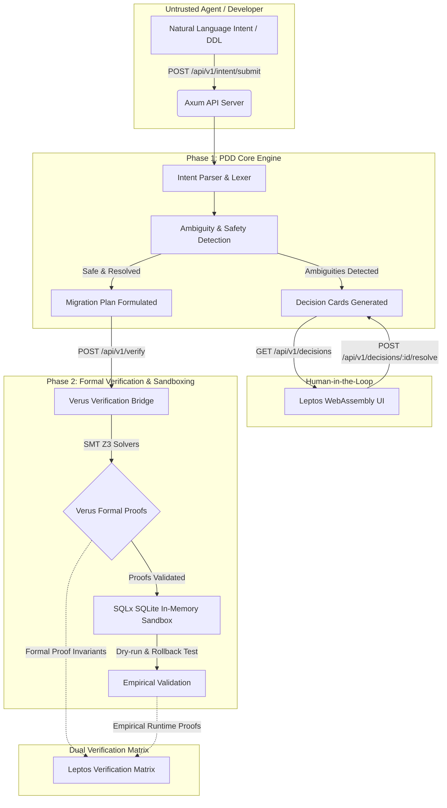

# AgentGuard: Verifiable Multi-Agent Migration Sandbox

AgentGuard is a full-stack verification sandbox that intercepts agent-generated database migrations and schema updates, running them through a **Proof-Driven Development (PDD)** planning loop, **Verus formal verification contracts**, and an **in-memory SQLite sandbox** to mathematically guarantee safety, non-destructiveness, and multi-tenant isolation before committing changes to production databases.

> 💡 **Developer / AI Assistant Continuity Guide**: See [PROJECT_HANDOFF.md](PROJECT_HANDOFF.md) for full context, architecture details, toolchain setup instructions for fresh environments, and next roadmap milestones.

---

## Architecture Overview



---

## Workspace Structure

The workspace is structured as a high-performance Cargo Monorepo:

- **`pdd-core/`**: Natural-language intent parser, ambiguity detection engine (tenant isolation, nullability missing defaults, destructive drops, missing indexes), and decision card resolution lifecycle.
- **`verus-specs/`**: Mathematical invariant contracts (`tenant_isolation_preserved`, `schema_addition_is_non_destructive`, `not_null_column_requires_default_or_nullable`) using dual-mode Verus macro shims.
- **`backend/`**: Axum 0.7 REST API, in-memory SQLite sandbox via SQLx with strict pooling and rollback validation, and Verus formal verification runner.
- **`frontend/`**: Leptos 0.6 WebAssembly client (CSR) featuring a 5-stage Live Intent Map flowchart, interactive decision card review, and a dual verification matrix.

---

## Getting Started

### Prerequisites

- [Rust](https://rustup.rs/) (1.80+)
- `wasm32-unknown-unknown` target:
  ```bash
  rustup target add wasm32-unknown-unknown
  ```
- [Trunk](https://trunkrs.dev/) for serving the Leptos frontend:
  ```bash
  cargo install trunk
  ```

---

### Running the Test Suite

Run all 17 unit and integration tests across all workspace crates:

```bash
cargo test --workspace
```

---

### Starting the Axum Backend

Start the backend server on port 3000:

```bash
cargo run -p backend
```

- **Base URL:** `http://127.0.0.1:3000`
- **Endpoints:**
  - `GET /api/v1/ws` — Real-time WebSocket log stream for forward DDL, rollback tests, and formal proofs.
  - `GET /api/v1/verify/capabilities` — Introspect Verus CLI / Z3 host prover capabilities and active solver mode.
  - `POST /api/v1/intent/submit` — Submit natural language migration or DDL statement.
  - `GET /api/v1/decisions` — Retrieve active clarification decision cards.
  - `POST /api/v1/decisions/{id}/resolve` — Human sign-off on a decision card.
  - `POST /api/v1/verify` — Trigger Verus formal verification proofs and export spec artifacts.
  - `POST /api/v1/sandbox/execute` — Execute SQLite transactional dry-run and rollback test.

---

### Starting the Leptos WASM Frontend

Start the Trunk development server:

```bash
cd frontend
trunk serve
```

Open `http://127.0.0.1:8080` in your browser.

---

## Formal Invariants Guaranteed

1. **Multi-Tenant Isolation**: Proves that all shared entities require strict tenant boundaries (`tenant_id NOT NULL`) and queries cannot cross tenant boundaries.
2. **Non-Destructive Schema Evolution**: Guarantees that schema updates (such as adding nullable columns or columns with defaults) do not destroy or corrupt existing records.
3. **Nullability Safety**: Guarantees that adding `NOT NULL` columns to existing tables requires a valid default value to prevent migration lockups.

